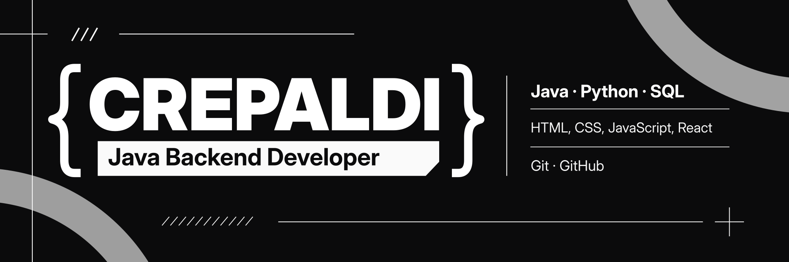

<!-- README de perfil | github.com/crepaldigor -->

  

   

  
  
  

  <h3>Desenvolvimento backend com Java como foco principal.</h3>
  

    Construindo uma base sólida em <strong>engenharia de software</strong>, com atenção a
    organização, qualidade de código e soluções que façam sentido na prática.
  

---

### `01` &nbsp; Sobre mim

Sou o **Crepaldi**, desenvolvedor com foco em **Java e backend**. Tenho conhecimentos em **Python, SQL e tecnologias front-end**, que ampliam minha visão sobre o funcionamento de aplicações de ponta a ponta.

- ☕ **Foco principal:** Java e desenvolvimento backend.
- 🧠 **Interesses técnicos:** arquitetura de software, orientação a objetos, boas práticas e APIs.
- 🌐 **Conhecimentos complementares:** desenvolvimento de interfaces com HTML, CSS, JavaScript e React.
- 🔧 **Fluxo de trabalho:** versionamento e colaboração com Git e GitHub.
- 📈 **Em evolução:** aprofundando conhecimentos e construindo projetos para aplicar os conceitos na prática.

### `02` &nbsp; Tecnologias

<table>
  <tr>
    <td width="31%" valign="top">
      <strong>☕ Principal</strong>  
        
      <strong>Java</strong> 
      Meu foco em desenvolvimento backend.
    </td>
    <td width="34%" valign="top">
      <strong>⚙️ Linguagens e dados</strong>  
        
      <strong>Python · SQL</strong> 
      Programação, automação e fundamentos de dados relacionais.
    </td>
    <td width="35%" valign="top">
      <strong>🌐 Front-end</strong>  
        
      <strong>HTML · CSS · JavaScript · React</strong> 
      Conhecimento complementar para interfaces e integração com aplicações.
    </td>
  </tr>
</table>

**Ferramentas de desenvolvimento**

### `03` &nbsp; Projetos em destaque

<table>
  <tr>
    <td width="50%" valign="top">
      <h4><a href="https://github.com/crepaldigor/File-Organizer">📁 File Organizer</a></h4>
      
Script em Python para organizar arquivos por extensão, com logs, tipagem e modo de simulação.

      
    </td>
    <td width="50%" valign="top">
      <h4><a href="https://github.com/crepaldigor/Admin-Dashboard">📊 Admin Dashboard</a></h4>
      
Dashboard administrativo em React, com componentes, hooks e estados de interface.

      
    </td>
  </tr>
  <tr>
    <td width="50%" valign="top">
      <h4><a href="https://github.com/crepaldigor/dividi-ai">💸 dividi-ai</a></h4>
      
Aplicação web para organizar despesas de grupos e famílias, desenvolvida com tecnologias front-end.

      
    </td>
    <td width="50%" valign="top">
      <h4>☕ Próximo capítulo: Java Backend</h4>
      
Minha prioridade atual é aplicar Java em projetos backend, aprofundando os fundamentos de engenharia de software.

      
    </td>
  </tr>
</table>

### `04` &nbsp; Atividade no GitHub

  

---

  
<strong>Backend first. Engineering always.</strong>

  Java como direção. Curiosidade e aprendizado contínuo como processo.

