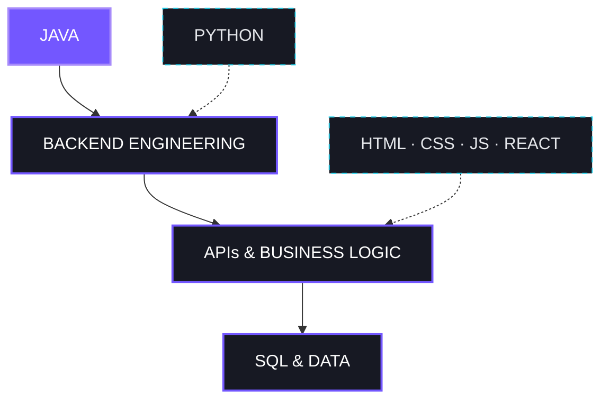

<!--
  CREPALDI / GITHUB PROFILE
  Visual: Monochrome + Electric Violet + Cyan

  Banner:
  O arquivo atualizado deve estar em assets/header.svg.
  Se você o salvou como crepaldi-banner.svg,
  altere o caminho da imagem abaixo.

  O parâmetro ?v=3 ajuda a renovar o cache da imagem.
  É necessário publicar o SVG atualizado no repositório.
-->

<div align="center">

  

  <br/>

  <a href="https://readme-typing-svg.demolab.com">
    
  </a>

  <br/>

  <a href="https://github.com/crepaldigor">
    
  </a>
  <a href="https://www.linkedin.com/in/igoralvesdossantos/">
    
  </a>
  <a href="https://codesantt.vercel.app/">
    
  </a>

  <br/><br/>

  
  

</div>

<br/>

<!-- ABOUT -->

<table>
  <tr>
    <td width="60%" valign="top">

### `01 /` About me

Desenvolvedor com foco em **Java Backend**, interessado em transformar problemas em soluções bem estruturadas.

Minha principal direção é o desenvolvimento de aplicações backend, com atenção aos fundamentos de **engenharia de software, orientação a objetos, arquitetura e qualidade de código**.

Também possuo conhecimentos em **Python, SQL e desenvolvimento Front-end**, que contribuem para uma visão mais completa do funcionamento de aplicações.

Meu objetivo é evoluir tecnicamente por meio do estudo contínuo, da construção de projetos e da aplicação de boas práticas.

</td>
<td width="40%" valign="top">

### `system / profile`

```yaml
developer: Crepaldi

primary:
  language: Java
  focus: Backend

knowledge:
  - Python
  - SQL
  - Front-end

tools:
  - Git
  - GitHub

principles:
  - Clean Code
  - Software Engineering
  - Continuous Learning
```

</td>
  </tr>
</table>

<br/>

<!-- TECHNOLOGIES -->

## 

<sub>TECHNOLOGIES, TOOLS & DEVELOPMENT ECOSYSTEM</sub>

<br/><br/>

<table>
  <tr>
    <td align="center" width="100%">

### `> PRIMARY FOCUS`


<br/>

**JAVA / BACKEND DEVELOPMENT**

<sub>Linguagem principal de estudo e especialização.</sub>

<br/><br/>


</td>
  </tr>
</table>

<table>
  <tr>
    <td align="center" width="50%">

### `> LANGUAGES & DATA`


<br/><br/>


<br/>

<sub>Programação, automação e dados.</sub>

</td>
<td align="center" width="50%">

### `> FRONT-END KNOWLEDGE`


<br/><br/>


<br/>

<sub>Conhecimentos complementares em interfaces e aplicações web.</sub>

</td>
  </tr>
</table>

<div align="center">

### `> DEVELOPMENT TOOLS`


<br/><br/>


</div>

<br/>

<!-- ENGINEERING MAP -->

## 

<sub>HOW MY TECHNICAL INTERESTS CONNECT</sub>

<br/><br/>



<div align="center">

`CORE: JAVA` &nbsp; · &nbsp; `DIRECTION: BACKEND` &nbsp; · &nbsp; `SUPPORT: FRONT-END + PYTHON`

</div>

<br/>

<!-- PROJECTS -->

## 

<sub>A SELECTION OF THINGS I'VE BUILT</sub>

<br/><br/>

<table>
  <tr>
    <td width="50%" valign="top">

### `01.` File Organizer


Script desenvolvido em Python para organização de arquivos por extensão.

O projeto explora automação, organização de código, registros de execução e simulação de operações.

<br/>

<a href="https://github.com/crepaldigor/File-Organizer">
  
</a>

</td>
<td width="50%" valign="top">

### `02.` Admin Dashboard


Dashboard administrativo desenvolvido com React.

Explora componentes reutilizáveis, gerenciamento de estados, organização de interfaces e responsividade.

<br/>

<a href="https://github.com/crepaldigor/Admin-Dashboard">
  
</a>

</td>
  </tr>
  <tr>
<td width="50%" valign="top">

### `03.` dividi-ai


Aplicação web voltada à organização de despesas de grupos e famílias.

Permite dividir contas e acompanhar informações financeiras, com persistência local dos dados.

<br/>

<a href="https://github.com/crepaldigor/dividi-ai">
  
</a>

</td>
<td width="50%" valign="top">

### `04.` Java Backend Journey


Minha direção atual de desenvolvimento.

Estudando Java e fundamentos de engenharia de software para construir aplicações backend com regras de negócio, organização e testes.

<br/>


</td>
  </tr>
</table>

<br/>

<!-- GITHUB ANALYTICS -->

## 

<sub>ACTIVITY / CONTRIBUTIONS / OPEN SOURCE</sub>

<br/><br/>

<div align="center">

  
  

  <br/><br/>

  

</div>

<br/>

<!-- ENGINEERING PHILOSOPHY -->

## 

<sub>THE PRINCIPLES BEHIND THE CODE</sub>

<br/>

<table>
  <tr>
    <td align="center" width="33%">

### `01 / CLARITY`

**Code should communicate.**

<sub>Legibilidade, simplicidade e organização.</sub>

</td>
<td align="center" width="33%">

### `02 / STRUCTURE`

**Design before complexity.**

<sub>Responsabilidades claras e soluções sustentáveis.</sub>

</td>
<td align="center" width="33%">

### `03 / EVOLUTION`

**Always keep learning.**

<sub>Estudo, experimentação e melhoria contínua.</sub>

</td>
  </tr>
</table>

<br/>

<!-- CONTACT -->

<div align="center">

## `LET'S CONNECT_`

Interessado em desenvolvimento backend, engenharia de software e oportunidades para evoluir construindo soluções reais.

<br/>

<a href="https://www.linkedin.com/in/igoralvesdossantos/">
  
</a>

<a href="https://codesantt.vercel.app/">
  
</a>

<br/><br/>

---


<br/>

<sub>CREPALDI © 2026 · DEVELOPED WITH PURPOSE.</sub>

</div>
